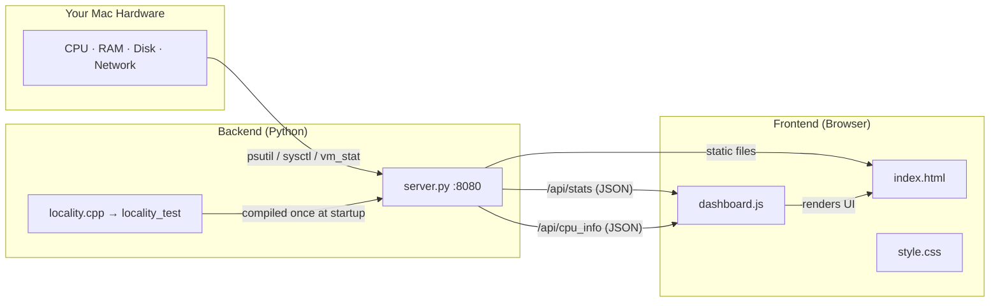
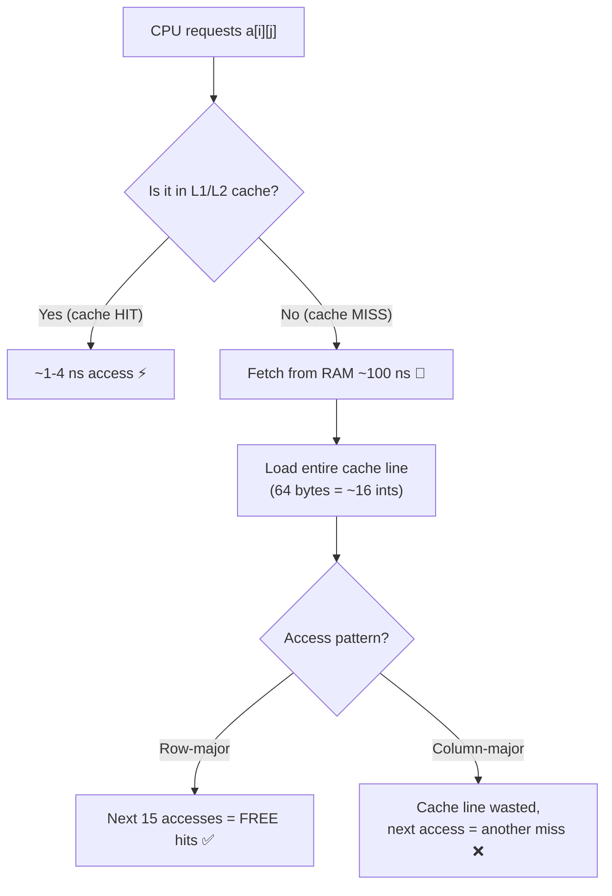
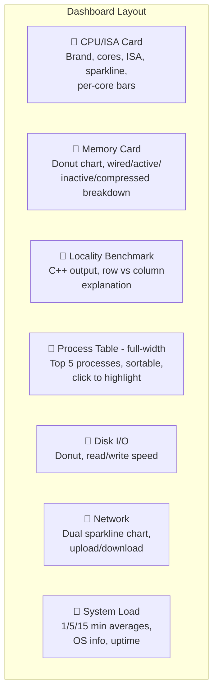

# 🖥️ OS Monitor Dashboard — Full Project Breakdown

> **Real-time macOS system monitor + CPU cache locality experiment**
> Built for CIE (Cambridge International) Operating Systems Activity

A **real-time macOS system monitor** built as a CIE Operating Systems activity. It runs a local Python server that reads your Mac's live hardware stats and displays them in a beautiful web dashboard — plus a **C++ cache locality experiment** that demonstrates how memory access patterns affect CPU performance.


---

## 📋 Table of Contents

- [Prerequisites](#-prerequisites)
- [Installation & Usage](#-installation--usage)
- [Architecture Overview](#-architecture-overview)
- [Project Structure](#-project-structure)
- [How It Works — Step by Step](#-how-it-works--step-by-step)
- [What `/api/stats` Collects](#-what-apistats-collects)
- [API Endpoints](#-api-endpoints)
- [The Locality Experiment — Deep Dive](#-the-locality-experiment--deep-dive)
- [The Dashboard UI — 7 Cards](#-the-dashboard-ui--7-cards)
- [Interactive Features](#-interactive-features)
- [Data Flow Summary](#-data-flow-summary)
- [Privacy & Security](#-privacy--security)
- [Troubleshooting](#-troubleshooting)
- [Tech Stack](#-tech-stack)
- [License](#-license)

---

## ⚙️ Prerequisites

| Requirement | Version | Check Command |
|-------------|---------|---------------|
| **macOS** | 10.15+ (Catalina or later) | `sw_vers` |
| **Python 3** | 3.8+ | `python3 --version` |
| **psutil** | Any | `pip3 install psutil` |
| **clang++** | Any (ships with Xcode CLI Tools) | `clang++ --version` |

### Install Dependencies

```bash
# Install Xcode Command Line Tools (if not already installed)
xcode-select --install

# Install psutil
pip3 install psutil
```

---

## 🚀 Installation & Usage

```bash
# 1. Clone or download the project
git clone <your-repo-url>
cd oscie

# 2. Install Python dependency
pip3 install psutil

# 3. Run the server
python3 server.py

# 4. Open in browser
open http://localhost:8080
```

**Expected startup output:**

```
  Compiling and running C++ locality experiment...
  Experiment done: Row=26.52ms, Col=80.81ms

====================================================
  OS Monitor Dashboard
  http://localhost:8080
  API: http://localhost:8080/api/stats
====================================================
```

**To stop the server:** Press `Ctrl+C`

---

## 🏗️ Architecture Overview



---

## 📁 Project Structure

```
oscie/
├── server.py          # Python HTTP server + system data collector (14.7 KB)
├── dashboard.js       # Frontend logic: fetching, charts, animations (31.2 KB)
├── index.html         # Dashboard UI layout (7 cards) (16.9 KB)
├── style.css          # Styling: dark theme, glassmorphism, animations (25.8 KB)
├── locality.cpp       # C++ cache locality benchmark (row vs column) (2 KB)
├── locality_test      # Compiled binary of locality.cpp (auto-generated)
└── README.md          # This file
```

| File | Role |
|------|------|
| `server.py` | Python HTTP server + real-time system data collector via `psutil`, `sysctl`, `vm_stat` |
| `dashboard.js` | Frontend logic: API fetching, Canvas chart rendering, animations, interactive controls |
| `index.html` | Dashboard UI layout with 7 stat cards, process table, and control bar |
| `style.css` | Styling: dark/light themes, glassmorphism, hover effects, CSS animations |
| `locality.cpp` | C++ cache locality benchmark — row-major vs column-major array access timing |
| `locality_test` | Compiled binary of `locality.cpp` (auto-generated at server startup) |

---

## 🔄 How It Works — Step by Step

### 1. You Run `python3 server.py`

Three things happen at startup:

```
① Compile + run locality.cpp  →  row-major vs column-major timings
② Cache static CPU info       →  brand, ISA, cores, frequency, cache sizes
③ Start HTTP server on :8080  →  serves files + JSON API
```

### 2. You Open `http://localhost:8080` in Your Browser

The server serves `index.html` as a static file. The HTML loads `style.css` and `dashboard.js`.

### 3. Dashboard Polls `/api/stats` Every 2 Seconds

This is the heartbeat of the app:

```js
setInterval(tick, 2000);   // data every 2s
```

Each `tick()` calls `fetchStats()` → `GET /api/stats` → server collects **real-time data** → returns JSON → dashboard renders it.

> **Note:** That's why you see `[API] /api/stats` repeating in your terminal — it's the dashboard refreshing every 2 seconds. Each line = one poll.

### 4. If the Server Is Down, It Falls Back to Simulated Data

The dashboard has a **fallback mode** (`renderSim()`). If the fetch fails, it generates fake animated data so the UI still looks alive. The badge switches from `LIVE · REAL DATA` to `SIMULATED DATA`.

---

## 📊 What `/api/stats` Collects

The `get_stats()` function in `server.py` gathers everything from your Mac:

| Category | What It Reads | How |
|----------|--------------|-----|
| **CPU** | Brand, ISA (ARM64/x86), cores, frequency, cache sizes, per-core usage % | `psutil` + `sysctl` |
| **Memory** | Wired, Active, Inactive, Compressed, Free, Swap (Activity Monitor–accurate) | `vm_stat` + `psutil` |
| **Disk** | Usage %, total/used/free GB, read/write MB/s | `psutil.disk_usage` + `disk_io_counters` |
| **Network** | Upload/download KB/s, total sent/received | `psutil.net_io_counters` |
| **Load** | 1-min, 5-min, 15-min load averages | `os.getloadavg()` |
| **Processes** | Top 5 by CPU: PID, name, state, CPU%, MEM%, threads | `psutil.process_iter` |
| **Locality** | Row-major vs column-major timings from C++ | Pre-computed at startup |
| **OS Info** | macOS version, kernel, hostname, uptime | `platform` + `psutil.boot_time` |

---

## 🔌 API Endpoints

| Endpoint | Method | Description |
|----------|--------|-------------|
| `/` | GET | Serves `index.html` (dashboard UI) |
| `/api/stats` | GET | Returns all real-time system stats as JSON |
| `/api/cpu_info` | GET | Returns static CPU info (brand, ISA, cores, caches) |

### Example `/api/stats` Response

```json
{
  "cpu": {
    "brand": "Apple M2",
    "isa": "ARM64 (AArch64)",
    "physical_cores": 8,
    "logical_cores": 8,
    "usage_total": 12.5,
    "usage_per_core": [8.2, 15.1, 3.4, ...]
  },
  "memory": {
    "total_gb": 16.0,
    "used_gb": 10.23,
    "wired_gb": 2.45,
    "active_gb": 4.12,
    "inactive_gb": 3.66,
    "compressed_gb": 0.89,
    "percent": 63.9
  },
  "locality": {
    "row_time_ms": 26.52,
    "col_time_ms": 80.81,
    "ratio": 3.047
  },
  "disk": { "pct": 55.2, "read_mb_s": 12.3, "write_mb_s": 4.1 },
  "network": { "sent_kb_s": 45.2, "recv_kb_s": 180.5 },
  "load": { "load1": 1.82, "load5": 1.45, "load15": 1.21 },
  "processes": [ ... ],
  "uptime_sec": 43200,
  "os": { "os": "Darwin 15.2", "kernel": "24.1.0", "machine": "arm64" }
}
```

---

## 🧪 The Locality Experiment — Deep Dive

This is the most interesting part from an OS/architecture perspective.

### What `locality.cpp` Does

It allocates a **5000 × 5000 integer matrix** (~100 MB) and sums all elements in two different orders:

#### Row-Major Access (Spatial Locality ✅)

```
for i = 0 to 4999:
  for j = 0 to 4999:
    sum += a[i][j]    ← sequential memory addresses

Memory layout:  [row0: 0,1,2,3...] [row1: 0,1,2,3...] ...
Access pattern: →→→→→→→→→→→→→→→→→→→→→→→→→→→→→→→→→→
                Cache line loaded = next ~16 values ready!
```

#### Column-Major Access (Spatial Locality ❌)

```
for j = 0 to 4999:
  for i = 0 to 4999:
    sum += a[i][j]    ← jumps across rows (5000 ints apart)

Memory layout:  [row0: 0,1,2,3...] [row1: 0,1,2,3...] ...
Access pattern: ↓........↓........↓........↓........↓
                Each access = cache miss → fetch from RAM!
```

### Benchmark Results

```
Row-major time    : 26520 microseconds  (26.52 ms)
Column-major time : 80810 microseconds  (80.81 ms)
Column-major is   : ~3.05x slower
```

### Why the Difference?



- **Row-major**: When you access `a[0][0]`, the CPU loads `a[0][0]` through `a[0][15]` into cache. Your next 15 accesses are instant.
- **Column-major**: When you access `a[0][0]`, then `a[1][0]` (5000 ints away), the cached data is useless. Every access causes a cache miss.

### How It Gets to the Dashboard

1. At server startup, `server.py` compiles and runs the C++ code **once**
2. Results are stored in `_LOCALITY_DATA` (a global Python dict)
3. Every `/api/stats` response includes `"locality": _LOCALITY_DATA`
4. The dashboard renders the raw C++ output in a terminal-style green box + shows the explanation

---

## 🖥️ The Dashboard UI — 7 Cards



| Card | Description |
|------|-------------|
| **CPU / ISA** | CPU brand, architecture (ARM64/x86), physical cores, logical threads, max frequency, L2/L3 cache, real-time usage bar + sparkline, expandable per-core bars |
| **Memory** | Multi-segment donut chart showing Wired/Active/Inactive/Compressed breakdown (Activity Monitor–accurate), swap usage, total RAM |
| **Locality Benchmark** | Raw C++ output in terminal-style box, row-major vs column-major timing comparison, explanation of spatial locality |
| **Process Table** | Top 5 processes sorted by CPU% (default), with PID, name, state badge (running/sleeping/waiting), CPU%, MEM%, thread count, CPU bar |
| **Disk I/O** | Donut chart for disk usage %, read/write speed in MB/s, free space display |
| **Network** | Dual sparkline chart (upload above center line, download below), real-time upload/download rates, total sent/received |
| **System Load** | 1-min, 5-min, 15-min load averages with progress bars, OS version, kernel version, hostname |

---

## 🎮 Interactive Features

| Feature | Description |
|---------|-------------|
| ⏸ **Pause/Resume** | Stop/resume the 2-second polling loop |
| 🔄 **Refresh** | Force an immediate data update |
| 🌙/☀️ **Theme Toggle** | Switch between dark mode and light mode |
| **Sort Buttons** | Sort process table by CPU%, MEM%, or PID |
| **Click Rows** | Click any process row to highlight it |
| **Per-Core Toggle** | Expand/collapse individual CPU core usage bars |
| **Hover Glow** | Cards track mouse position for dynamic glow effect |
| **Background Particles** | 40 animated dots floating in the background |
| **Analog Clock** | Canvas-rendered analog clock with smooth second hand |
| **Simulated Fallback** | If server is down, dashboard runs with fake animated data |

---

## 📈 Data Flow Summary

```
┌─────────────────────────────────────────────────────────┐
│                    STARTUP (once)                        │
│                                                         │
│  clang++ locality.cpp → run → parse timings             │
│  sysctl → CPU brand, ISA, caches                        │
│  psutil → core/thread count, frequency                  │
│                                                         │
│  Start HTTP server on :8080                             │
└─────────────┬───────────────────────────────────────────┘
              │
              ▼ every 2 seconds
┌─────────────────────────────────────────────────────────┐
│                  POLLING LOOP                            │
│                                                         │
│  Browser: fetch('/api/stats')                           │
│     ↓                                                   │
│  Server: get_stats()                                    │
│     → psutil.cpu_percent()      (CPU usage)             │
│     → vm_stat                   (memory breakdown)      │
│     → psutil.disk_usage('/')    (disk space)            │
│     → psutil.disk_io_counters() (disk speed)            │
│     → psutil.net_io_counters()  (network speed)         │
│     → os.getloadavg()          (load averages)          │
│     → psutil.process_iter()    (top 5 processes)        │
│     → _LOCALITY_DATA           (pre-computed)           │
│     ↓                                                   │
│  Returns JSON → Browser renders with Canvas charts      │
│                                                         │
│  Terminal prints: [API] /api/stats                      │
└─────────────────────────────────────────────────────────┘
```

> **Tip:** The `[API] /api/stats` log in your terminal is just the server's `log_message` printing every API hit. It's purely cosmetic logging — you can safely ignore it.

---

## 🔒 Privacy & Security

- **100% Local** — The server runs on `localhost:8080` only. No data ever leaves your machine.
- **Zero external API calls** — No analytics, no telemetry, no cloud services.
- **Read-only** — The server only reads system stats. It does not modify, write, or delete anything.
- **No authentication** — Since it's local-only, no login is needed. Don't expose port 8080 to the internet.

---

## 🛠️ Troubleshooting

| Problem | Solution |
|---------|----------|
| `ModuleNotFoundError: No module named 'psutil'` | Run `pip3 install psutil` |
| `clang++: command not found` | Run `xcode-select --install` |
| Port 8080 already in use | Change `PORT = 8080` in `server.py` to another port |
| Dashboard shows `SIMULATED DATA` | Make sure `server.py` is running, then refresh the browser |
| `[API] /api/stats` flooding terminal | This is normal — the dashboard polls every 2 seconds |
| Locality experiment shows 0ms | The C++ compilation may have failed — check terminal output at startup |

---

## 🧰 Tech Stack

| Layer | Technology | Purpose |
|-------|-----------|---------|
| **Backend** | Python 3 + `psutil` | System data collection + HTTP server |
| **Experiment** | C++17 + `clang++` | Cache locality benchmark (row vs column array access) |
| **Frontend** | Vanilla HTML/CSS/JS | Dashboard UI with Canvas charts |
| **System APIs** | `sysctl`, `vm_stat`, `psutil` | macOS-specific hardware introspection |
| **Fonts** | Google Fonts (Inter, JetBrains Mono) | Typography |

---

## 👨‍💻 Author

**Nadeem Shaikh**

CIE Operating Systems Activity — OS Monitor Dashboard

---

## 📄 License

This project is for educational purposes (CIE Operating Systems coursework).
